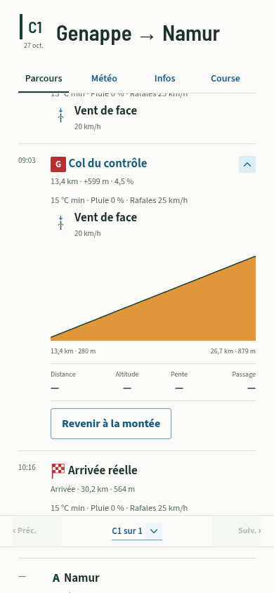
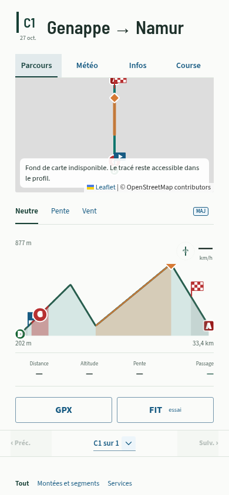
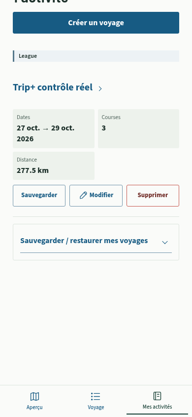

# Montées, segments et repères de parcours — 2026.10.27.3

Ce lot reprend les demandes du 27 octobre : retirer le raccourci eau, rendre une montée convertible et réversible, et utiliser les mêmes repères sur carte, profil et parcours. Les échanges ont précisé **League/Tour uniquement pour la conversion**, et **conservation des sommets/cols nommés**, sans garder les montées génériques remplacées.

## Conversion réversible

Dans une fiche de montée dépliée, **Convertir en Grimpeur** crée le segment avec le nom et les limites précises détectées. La montée doit être entièrement comprise dans la course courante. Les limites ne sont pas arrondies par cette conversion, même si les champs d’édition les présentent au dixième de kilomètre.

La conversion ne supprime pas la montée détectée. Le segment créé porte une relation vers elle dans les champs de provenance déjà existants. **Revenir à la montée**, dans la fiche du segment dépliée, retire uniquement ce segment. Les autres segments et les fichiers GPX restent conservés. La relation survit à un rechargement et aux sauvegardes usuelles. Un double appui ne crée pas deux segments issus de la même montée. Le contrôle du parcours s’effectue dans la transaction sur la dernière version du voyage ; un parcours modifié ou une montée disparue produit une erreur explicite. Si une nouvelle détection a supprimé la montée d’origine, le retour arrière conserve le segment et indique comment le gérer depuis Course.

La liste reste consolidée : les segments gardent la priorité sur les montées qu’ils chevauchent. Si un autre segment manuel chevauche encore la montée après le retour arrière, il garde cette priorité ; le bouton ne supprime pas les autres segments pour forcer sa réapparition.

## Même lecture sur les trois surfaces

| Élément | Carte et profil | Parcours |
| --- | --- | --- |
| Montée détectée conservée | Portion **orange**, identique au repère de col/sommet. Le profil la teinte en Neutre ; Pente et Vent gardent leur coloration propre. | Fiche de montée existante, dépliable et convertible en compétition. |
| Segment | Portion Sprint/Grimpeur/Flandrien dans sa couleur et **bulle S/G/F au milieu par distance sur le tracé**, même dans une boucle ; aucune moyenne des coordonnées géographiques. | Fiche au début du segment, avec ses statistiques et son profil. Le déplacement de la bulle ne déplace ni les limites, ni les alertes, ni l’horaire de la fiche. |
| Sommet/col nommé remplacé | **Losange orange conservé**, indépendant de la bulle du segment. | La montée reste masquée pour éviter le doublon. |
| Montée générique remplacée | Son repère générique est masqué. | La fiche du segment la représente. |
| Départ et arrivée GPX | **D/A** aux extrémités du tracé intégral, avec leurs villes/noms d’origine. | Villes conservées, chaînage et altitude connue, météo et vent disponibles. |
| Départ réel distinct | Drapeau **bleu avec triangle blanc** au point de départ de course. | Même drapeau, nom générique Départ réel autorisé. |
| Arrivée réelle distincte | Drapeau **à damier rouge/blanc** au point d’arrivée de course. | Même drapeau, nom générique Arrivée réelle autorisé. |

Un départ/une arrivée identique à l’extrémité GPX ne crée pas un second drapeau au même point. Le grisé du profil indique les portions hors course. Les guides verticaux des limites ne sont dessinés que pendant leur placement ; le curseur de lecture conserve sa ligne pointillée.

Les repères de carte sont nommés à l’ajout effectif de leur élément Leaflet, une fois la carte prête. Les symboles du profil et les points de lecture compensent l’étirement SVG pour garder leur taille et leur forme à différentes largeurs. Les bulles, losanges et drapeaux ne deviennent pas des ellipses en vue large.

## Mini-profils et points de passage

La bulle flottante des mini-profils est remplacée par une **bande fixe sous le graphique**, avec Distance, Altitude, Pente et Passage. La distance est le chaînage de l’étape, comme dans le profil principal. L’heure provient de la même courbe de temps que le parcours. Le retrait du doigt, la sortie du pointeur ou Échap efface la lecture sans déplacer le contenu ; les flèches du clavier restent utilisables.

Les points et services reprennent une colonne d’horaire de largeur commune, le nom, les petites statistiques et la météo/vent disponibles. Un horaire inconnu est représenté par un tiret. La météo d’un service peut réutiliser un point existant à moins de 1 km, signalé **Météo proche** ; cette mise en forme ne déclenche pas de recherche météo supplémentaire. Les services rattachés explicitement à une autre étape ne sont pas empruntés à celle-ci.

L’ETA du GPX après une arrivée réelle anticipée reste inconnue dans le modèle actuel : elle est affichée « — », sans inventer un rythme ou une prévision après la course. L’arrivée sportive et les horaires de course gardent leur définition existante.

## Carte compacte et activités

Une carte compacte pouvait être créée alors que son onglet était masqué, puis seulement redimensionnée sans recalculer son zoom. Elle recadre désormais le **GPX complet** lorsqu’elle reçoit une taille visible, au retour dans Parcours et aux changements de largeur. Son observateur est détruit avec la carte. La carte plein écran conserve son zoom/pan propre.

Mes activités présente une petite bannière **Voyage / Tour / League** sur chaque fiche. Le résumé fournit maintenant les trois modes, au lieu de ne transmettre que League ; les Tours historiques utilisant `raceMode` sont aussi reconnus. La bannière reste informative, distincte du bleu des actions.

Le bloc **Eau indiquée potable** sous le profil et son branchement sont supprimés. Les lieux d’eau, leurs tags et les autres POI enregistrés restent dans le voyage et dans Services.

## Vérification

- Compilation TypeScript et build Vite.
- Suite complète : **2 317 tests**, dont sept nouveaux tests couvrant conversion exacte, idempotence, réversion isolée, limites invalides, sommets nommés/génériques, bulles centrales, extrémités GPX et drapeaux, persistance IndexedDB et trois modes d’activité. Les six tests du raccourci eau supprimé sont retirés ; les tests POI/services sont conservés et adaptés au format commun.
- Contrôle source déterministe : League/Tour, conversion et retour arrière, conservation du sommet nommé, drapeaux, absence de lignes de limites en consultation, noms GPX, bande stable et point rond à 320/390/1080 px, cadrage après onglet masqué et redimensionnement, services Voyage, erreurs locales et reprise d’export. Pas d’erreur JavaScript non gérée dans ces scénarios.
- Contrôle du build compilé : vrais GPX dont 150 km, onglets, profils, cartes, champs mobiles, bannières League/Tour, exports GPX/FIT et comparaison des 1 514 points d’origine, randonnée et sauvegarde/restauration hors connexion.

L’origine du site, l’identité PWA et la version de base IndexedDB sont conservées. Aucun voyage n’est migré ou supprimé ; aucune réinstallation n’est nécessaire. Le rendu physique iOS et les alertes sur Garmin restent à vérifier sur les appareils.

Captures du contrôle isolé, données synthétiques et réseau cartographique volontairement bloqué :

