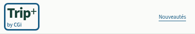
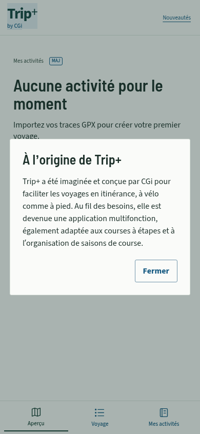

# Trip+ by CGi — 2026.10.27.5

La signature choisie par l’utilisateur est **Trip+ by CGi**. Dans l’en-tête commun des écrans principaux, le nom Trip+ garde sa taille et sa couleur ; **by CGi** apparaît en petit, en bleu d’action. L’ensemble forme une cible tactile d’au moins 44 × 44 px sans élargir le nom ni ajouter de ligne à la navigation.

Le toucher ou le clavier ouvre une courte fenêtre :

> Trip+ a été imaginée et conçue par CGi pour faciliter les voyages en itinérance, à vélo comme à pied. Au fil des besoins, elle est devenue une application multifonction, également adaptée aux courses à étapes et à l’organisation de saisons de course.

La fenêtre se ferme avec **Fermer** ou **Échap**, puis rend le focus à la signature. Le texte reste disponible hors connexion, sans requête réseau ni lecture/écriture des voyages. Son ouverture n’ajoute pas de navigation à l’historique.

Le même récit est conservé dans un **commentaire de `index.html`**, avec une métadonnée `author` valant `CGi`. Le commentaire est présent dans le HTML compilé : il reste consultable dans le code source de la page publiée, sans apparaître sur la page elle-même. Le texte de la fenêtre est défini dans `src/ui/creator-credit.ts`. Il s’agit d’une attribution de la conception, sans modifier la licence du projet.

## Vérification

- Build TypeScript/Vite réussi ; commentaire et métadonnée conservés dans `dist/index.html`.
- Suite globale sans échec : 2 319 cas passés et un cas dépendant de `dist` ignoré pendant la compilation parallèle. La suite PWA a ensuite été exécutée après compilation : **10/10**, dont ce cas, sans aucun cas ignoré. Les 2 320 cas sont ainsi couverts.
- Build compilé testé en Chromium tactile à 320/390/430 px : cible ≥ 44 px, note contenue dans l’écran, toucher de « by CGi », ouverture avec Entrée, fermeture par bouton et Échap, retour du focus, absence de débordement ou de navigation et fenêtre unique après plusieurs ouvertures.
- Nouvelle ouverture après rechargement et restauration **hors connexion** ; les scénarios GPX/FIT, cartes, onglets et sauvegardes du contrôle mobile existant passent aussi, sans erreur JavaScript dans les scénarios exécutés.

Captures d’un navigateur isolé, sans données personnelles. Le contour bleu de la première capture correspond au focus clavier ; il n’est pas affiché en permanence.

L’identité PWA, le nom d’installation, l’origine du site et le stockage sont conservés. Aucun voyage n’est modifié et aucune réinstallation n’est nécessaire. Le rendu sur un iPhone physique reste à contrôler.
