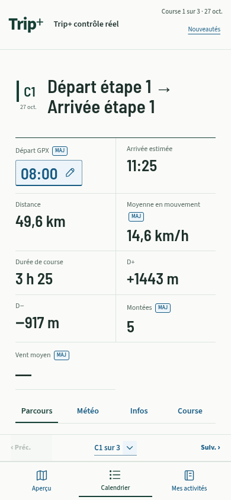
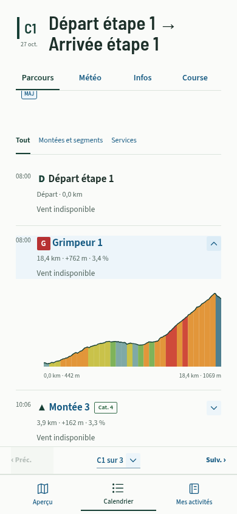
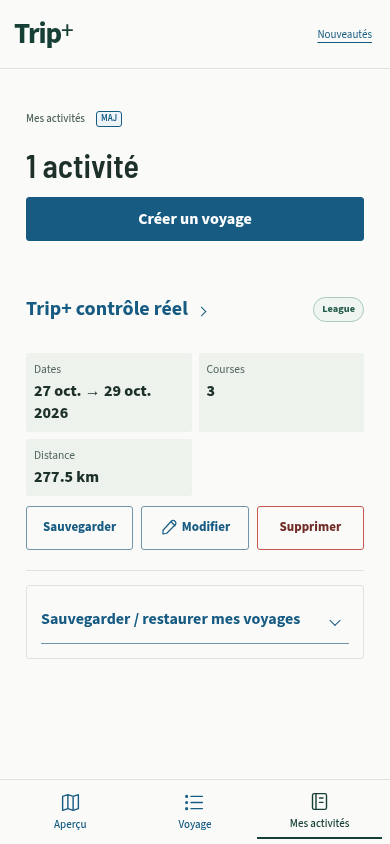

# Repères d’interaction — 2026.10.27.2

La refonte avait rendu certains contrôles trop semblables au texte informatif. Ce lot rétablit un vocabulaire commun dans Trip+, en particulier pour l’heure de départ et les profils de montée/segment.

| Usage | Représentation |
| --- | --- |
| Agir, ouvrir une page ou suivre un lien | Bleu d’action `#175b83`, bouton encadré ou rempli, nom accompagné d’une flèche dans les listes ouvrables. |
| Modifier une valeur | Même bleu, cadre visible et petit crayon SVG. L’heure de départ garde sa grande valeur lisible et ouvre sa fenêtre habituelle ; les boutons Modifier utilisent le même crayon, y compris depuis Météo. |
| Déplier/replier | Nom bleu et chevron vers le bas ; chevron vers le haut lorsque le contenu est ouvert. Même repère pour les montées, segments, réglages de course, options avancées et sauvegardes. |
| Choix actuellement actif et identité | Vert profond conservé pour l’identité Trip+ et les sélections d’onglet, activité, mode et profil. |
| Supprimer ou retirer | Texte et contour rouges, sans concurrencer l’action principale. Cela couvre aussi les segments et les retraits dans les formulaires. |
| Information à lire | Couleur de texte habituelle. L’arrivée estimée n’a ni crayon ni cadre d’édition. Les couleurs des pentes, segments, étapes et risques météo gardent leur sens propre. |

Les règles communes sont regroupées dans `src/ui/interaction-affordances.css`, chargé après le thème. Les pictogrammes proviennent de `src/ui/icons.ts` ; les chevrons des volets natifs reprennent leur forme en CSS. Le repère visuel ne remplace ni le libellé ni l’état accessible : `aria-expanded` reste celui du vrai contrôle, et les icônes décoratives sont masquées aux lecteurs d’écran.

La couleur n’est donc pas le seul indice : cadre, crayon, chevron et libellé indiquent l’action. Les clics sur les pictogrammes rejoignent les boutons existants ; aucun second gestionnaire de navigation/édition n’est ajouté. Les contrôles natifs, les protections de largeur iPhone et les cibles de 44 px restent utilisés. Les petites balises MAJ conservent leur format existant.

Le bleu présente un contraste d’environ **7,07:1** avec le fond principal, **6,66:1** avec le fond bleu léger et **7,34:1** pour le texte blanc des boutons principaux. Le contour des champs atteint environ **3,06:1** sur le fond principal. Le focus clavier est bleu et visible. Le retour tactile natif utilise une teinte bleue légère, sans supprimer le retour visuel.

## Vérifications

- `npm test` : **2 316 tests réussis**, aucun test ignoré. Les assertions de rendu existantes ont été adaptées à la présence des SVG décoratifs ; les mêmes actions et calculs sont vérifiés.
- `npm run build` : TypeScript et construction réussis.
- `python scripts/check-tripplus-mobile.py` sur le build compilé : cadre et crayon du départ, couleurs des valeurs informatives distinctes, cibles de 44 px, trois boutons d’activité sur une rangée à **320/390/430 px**, clic tactile sur le chevron du segment, rotation à l’ouverture, activation par Entrée/Espace, suppressions distinctes et absence de débordement. Le parcours d’intégration conserve aussi ses contrôles d’édition, carte, profils, GPX/FIT, randonnée et sauvegarde/restauration hors connexion. Aucune erreur JavaScript non gérée dans ces scénarios.
- `python scripts/check-route-information.py` : écran isolé avec le même thème, GPX synthétique et météo/POI déterministes ; contrôles League/Tour et services Voyage, limites, carte et erreurs locales conservés.

Les captures proviennent de Chromium tactile sur le vrai build, avec les tuiles et la météo réseau volontairement bloquées. La vérification physique sur iPhone reste à faire après fusion et déploiement. Les données locales et l’identité PWA sont conservées : aucune réinstallation nécessaire.

