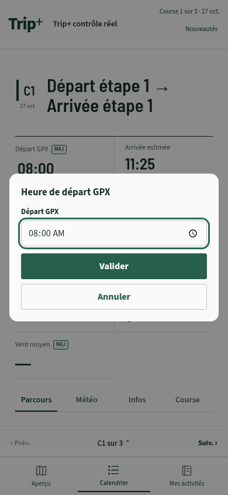
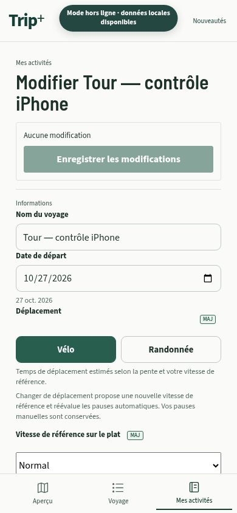
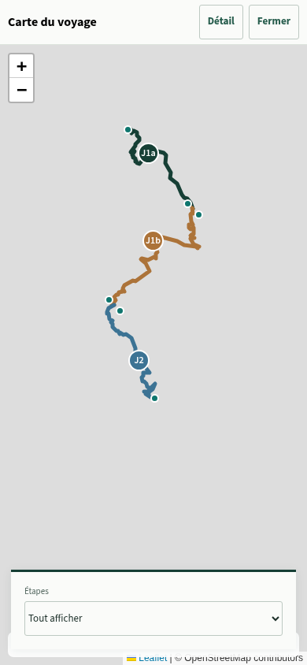

# Correctifs iPhone et repères Tour — 2026.10.26.2

> Les trois pistes suivantes sont intégrées au [lot 2026.10.26.3](ROUTE_INFORMATION_POLISH.md), avec un repère d’eau et des fiches de carte en compétition.

Ce lot répond au retour terrain après la refonte Trip+.

- Date et heure : contraintes de largeur communes, suppression de la largeur native imposée par WebKit et fenêtre de départ GPX à largeur explicite. Les sélecteurs restent natifs ; aucune date ou heure n’est changée pour corriger l’affichage.
- Encoche : l’en-tête garde son espacement supérieur, le fond protège la zone de statut et les éléments collants restent sous cette zone. Les onglets et le défilement vers le profil utilisent le même décalage. La barre d’état iOS utilise le style standard clair, assorti au fond et au thème du manifeste, plutôt que l’ancien mode noir translucide prévu pour l’en-tête sombre.
- Profils : la lecture existe pendant le contact tactile, le survol ou l’exploration au clavier. Elle s’efface au relâchement du doigt, à l’annulation du geste, à la sortie du tracé, à la perte de focus ou avec Échap. Le grand profil garde sa hauteur et ses valeurs reviennent à « — » ; le mini-profil masque sa bulle. Les positions choisies dans Course restent des valeurs du formulaire, indépendantes de cette lecture temporaire.
- Pictogrammes : liaison d’étapes, attente de connexion et localisation utilisent des SVG monochromes de la bibliothèque commune. Les libellés accessibles et les états de chargement sont conservés.
- Tour : plusieurs étapes du même jour portent J1a, J1b, J2a… dans la carte, les listes, le détail et la navigation. Une étape seule garde J1 ; League garde C1, C2… Les numéros calendaires, identifiants, dates et données enregistrées ne changent pas.
- Continuité : en Tour, seul un écart supérieur à 1 km entre des étapes explicitement liées est signalé, pour vérifier la liaison et les horaires. Entre journées indépendantes, pas d’alerte. Voyage conserve la vérification entre étapes consécutives ; repos, transfert ou GPX illisible interrompent la chaîne. League reste indépendant. Aucune alerte de distance ne bloque l’enregistrement.

## Contrôles

`npm run build` et `npm test` : **2 296 tests réussis**, sans échec ni test ignoré. Les nouveaux tests couvrent le cycle tactile/souris/clavier, les suffixes et leur cohérence entre vues, et la politique de continuité. Le contrôle de l’éditeur vérifie également que l’alerte apparaît après liaison, et disparaît entre étapes indépendantes.

`python scripts/check-tripplus-mobile.py` sur le build compilé : formulaires League et Tour, édition de date et fenêtre d’heure à 320/390/430 px, contact tactile sur les deux profils, maintien de la hauteur, marge supérieure simulée de 59 px et carte J1a/J1b/J2 hors connexion. Les contrôles précédents sur 150 km, GPX/FIT, polices, randonnée et rechargement hors connexion restent actifs. Aucune erreur JavaScript dans ces scénarios.

La simulation utilise Chromium tactile. Le téléchargement du moteur WebKit a reçu une réponse réseau 403 dans cet environnement ; ces résultats ne constituent donc pas une validation du sélecteur natif d’iOS ou de l’encoche physique. Après déploiement, vérifier sur l’iPhone déjà installé : dates/heures et sélecteurs, encoche en portrait/paysage, retrait du doigt et défilement des profils. Aucune réinstallation ni suppression des voyages n’est nécessaire.

## Pistes suivantes, non incluses

1. Une échelle commune de couleurs de pente sur le grand profil et les mini-profils : les deux palettes actuelles diffèrent.
2. Un repère discret lorsque la prévision météo est ancienne, utile en itinérance avec des périodes sans réseau.
3. Une représentation plus légère des portions hors course pour mieux distinguer approche, départ réel et arrivée, en conservant le tracé GPX complet.

Captures de contrôle :

