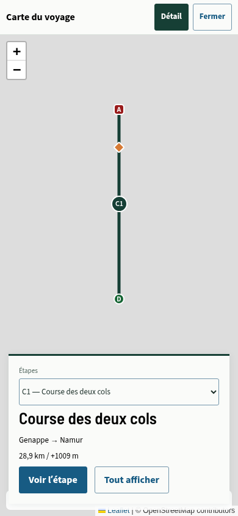
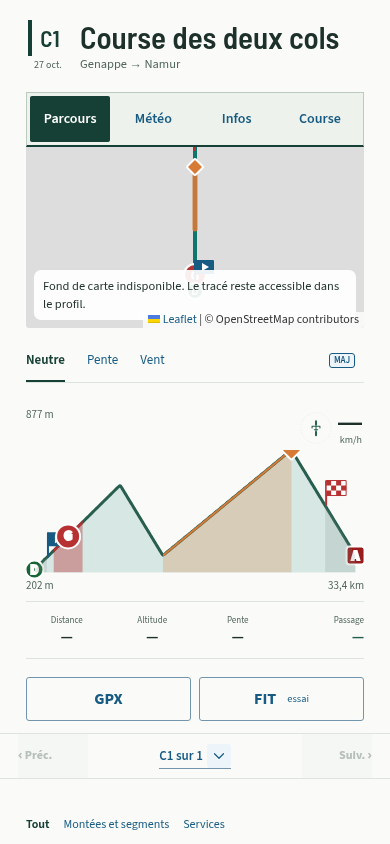

# Aperçu et onglets — 2026.10.27.4

Ce lot suit les choix confirmés le 27 octobre : **D/A GPX de chaque étape**, **pauses et cols nommés seulement avec Détail**, et **fiche d’étape conservée avec ses villes**, même lorsqu’un nom personnalisé existe. Il renforce aussi la visibilité de Parcours / Météo / Infos / Course.

## Carte de tout le voyage

| Vue | Informations visibles |
| --- | --- |
| Carte compacte d’Aperçu | GPX complet de chaque étape dans sa couleur, bulle C/J et départ/arrivée GPX. |
| Carte plein écran, Détail inactif | Même contenu, sélection d’une étape depuis sa bulle, son tracé ou la liste. |
| Carte plein écran, Détail actif | Ajout des pauses et des cols/sommets nommés associés à une montée. Aucun service ou village supplémentaire. |
| Survol d’une bulle sur ordinateur | Numéro, nom et villes Départ → Arrivée ; l’étiquette disparaît à la sortie. |
| Toucher/clic d’une bulle | Fiche existante : nom, villes si elles ne répètent pas le nom, distance, D+, Voir l’étape et Tout afficher. Le tracé sélectionné garde sa mise en évidence. |

Les limites **réelles** de course sont exclues de la carte globale, dans le modèle de vue comme dans les deux constructeurs de couches. Le GPX conserve tout son tracé. Le détail de chaque étape garde ses drapeaux réels, ses segments et son profil ; les statistiques sportives restent calculées sur la course.

Les extrémités GPX utilisent les symboles D/A partagés avec le détail. Leurs noms restent accessibles aux lecteurs d’écran, sans étiquette de ville ajoutée sur ces points. Les règles existantes de regroupement des lieux identiques sont conservées.

**Détail n’affiche plus tous les noms d’étapes en permanence.** Le contrôle est masqué s’il n’existe aucune pause ni aucun col à révéler. Un col nommé conserve sa place dans cette couche lorsqu’un Grimpeur remplace sa montée ; cela ne réintroduit pas la montée dans la liste du parcours.

## Onglets d’étape

La barre reste au même emplacement, après les statistiques, et garde son comportement fixe au défilement avec la zone de sécurité iPhone. Elle utilise un fond vert très clair, un contour continu et une base vert profond. L’onglet actif devient vert profond avec texte blanc ; les autres gardent le bleu des actions.

Les cibles tactiles mesurent au moins 44 px. Les trois onglets Voyage et les quatre onglets League/Tour restent visibles sans défilement horizontal à 320 px. La navigation clavier, les rôles et les attributs de sélection restent conservés. Une balise MAJ de navigation est disponible immédiatement sous la barre.

## Contrôles

- Build TypeScript/Vite et suite complète : **2 320 tests réussis**. Trois cas supplémentaires couvrent les limites réelles en League/Tour, les villes sous un nom personnalisé et le maintien d’un col remplacé par un segment dans Détail ; les attentes historiques de symboles et de limites globales sont adaptées à la demande.
- Navigateur sur code source : carte compacte et plein écran en League/Tour, bascule Détail, col nommé conservé après conversion, survol temporaire, fiche unique avec villes et navigation vers l’étape.
- Build compilé en Chromium tactile à 320/390/430 px : les quatre onglets se sélectionnent et présentent le fond vert et le texte blanc attendus, avec des cibles d’au moins 44 px et sans débordement. Parcours long de 150 km, cartes et sélection d’étape, GPX/FIT et sauvegarde/restauration hors connexion restent vérifiés par le contrôle mobile existant.

Les captures utilisent un navigateur isolé, des données de contrôle et un fond cartographique volontairement indisponible. Aucune donnée personnelle n’est utilisée. Le rendu sur un iPhone physique reste à contrôler.

L’origine du site, l’identité PWA, le stockage et les fichiers sources ne changent pas. Aucune réinstallation n’est nécessaire.
