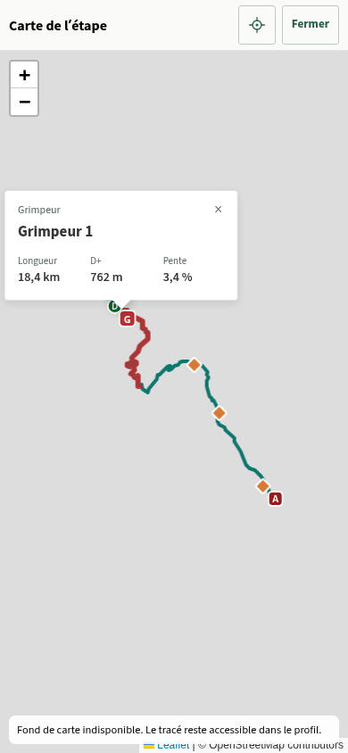

# Passe de contrôle Trip+ — 27 octobre 2026

Version proposée : **2026.10.27.1**, après la fusion du lot d’informations de parcours. Cette passe corrige le doublon de fiche signalé sur iPhone, puis contrôle les principales fonctions par lecture du code, tests de régression et parcours dans le navigateur.

## Défauts corrigés

| Défaut constaté | Correction et preuve |
| --- | --- |
| Une fiche de montée/segment et son étiquette de nom apparaissaient ensemble. | Un point ou une ligne possédant une fiche n’a plus de seconde infobulle. La règle s’applique aussi aux fiches de services. Les autres repères gardent leur étiquette et les marqueurs leur nom accessible. Contrôle tactile sur les vrais GPX et sur des données déterministes, avec une seule fiche visible. |
| Une carte compacte remplacée après modification restait enregistrée sur son ancien élément enfant. | Destruction du véritable canevas avant remplacement, avec libération des écouteurs Leaflet. Après modification du départ, l’ancien élément n’a plus de carte active ; le nouveau reste exploitable. Le bouton Fermer ne cumule plus de gestionnaires lors des mises à jour du même écran. |
| Une fermeture native du dialogue pouvait laisser le défilement de la page bloqué. | Échap et `close()` natif passent par le nettoyage des cartes, de l’historique et du verrou de défilement. Un événement de fermeture ancien n’affecte pas une carte déjà rouverte. Reproduction du défaut avant correction, puis contrôle de la carte d’étape et d’Aperçu. |
| Retour dans Calques, en Voyage, fermait directement toute la carte. | Le panneau générique est raccordé au contrôleur d’historique existant. Retour ferme la fiche, puis le panneau lorsqu’il est ouvert, puis la carte ; la fermeture normale du panneau consomme aussi son entrée. Reproduction avant correction et contrôle dans le navigateur après correction. |
| Une lecture terminée en retard pouvait réafficher la liste au-dessus d’un formulaire, ou ouvrir le voyage après un retour à Mes activités. | Les rendus et demandes de navigation obsolètes sont ignorés. Deux tests d’intégration reproduisaient ces scénarios avant correction et passent après correction. Aucun délai artificiel n’est ajouté à la navigation. |
| Une erreur de lecture locale pouvait laisser « Chargement… » sans issue. | L’écran affiche une erreur avec Réessayer. Les échecs d’actualisation préservent le contenu déjà affiché ; un échec de recherche du voyage actif préserve le formulaire courant. Une erreur locale injectée, suivie d’un nouvel essai, restitue le voyage existant. Aucun effacement ni création d’une base de remplacement. |
| L’export GPX d’origine pouvait ne rien faire si le fichier manquait ; l’archive pouvait omettre une étape sans le dire. | Préparation et erreur visibles, bouton réactivé après échec. L’archive complète est préparée ou explicitement refusée. Les octets d’origine sont conservés et un nouvel essai après rétablissement de la source fonctionne. Le module d’export est séparé du gestionnaire d’interface pour tester ces erreurs avec le vrai dépôt IndexedDB. |
| Les suffixes ZIP pouvaient eux-mêmes créer un doublon : `Étape.gpx`, `Étape (2).gpx`, puis `Étape.gpx`. | Les noms produits sont vérifiés contre tous les noms déjà utilisés. Chaque contenu reste extractible séparément. Le drapeau UTF-8 est écrit dans les deux en-têtes ZIP pour les noms accentués. Le lecteur des sauvegardes accepte toujours les anciennes archives. |
| Une durée proche de l’heure suivante pouvait s’afficher « 0 h 60 ». | L’arrondi porte sur le total des minutes avant séparation heures/minutes. Le détail affiche « 1 h 00 » pour 3 599 secondes ; le calcul des ETA n’est pas modifié. |

## Contrôle des fonctions

La demande complémentaire de l’utilisateur est intégrée : **départ réel et arrivée réelle au dixième de kilomètre**, avec `step="0.1"`, une décimale affichée, arrondi à la validation de la saisie ou du choix sur le profil. Les valeurs négatives et hors tracé restent refusées. La fin du GPX conserve sa position exacte, même si sa représentation arrondie est légèrement supérieure à la longueur mesurée ; une ancienne limite non modifiée garde sa précision. Il n’y a ni migration des anciennes valeurs ni modification du GPX. Contrôles unitaires et navigateur, dont modification d’un seul champ sans altérer l’autre limite.

| Domaine | Vérification et résultat |
| --- | --- |
| Mobile et profils | Largeurs 320, 390 et 430 px, champs natifs date/heure, en-tête avec zone supérieure simulée de 59 px, navigation au pouce, onglets, profil partagé avec Course, effacement des lectures tactiles, coloration adaptée aux parcours longs : contrôles réussis, sans débordement horizontal. |
| Cartes | Aperçu avec trois étapes, couleurs et étiquettes, sélection, ouverture d’une étape, fiches de montée/segment, accès plein écran depuis le marqueur compact, fermeture pendant un zoom et fermeture native : contrôles réussis. League/Tour restent sans Calques ; Voyage conserve ses services. |
| POI et connexion | Les tests de subdivision, progression, reprise, cache et erreurs fournisseur passent. L’interface conserve les lieux préparés, sans nouvelles recherches pendant l’exploration du profil. Ces tests sont déterministes ; ils ne mesurent pas la disponibilité réelle d’Overpass/Postpass à cet instant. |
| Météo et vent | Tests des coordinations météo, alertes, horaires et vent relatif réussis. Contrôle d’une prévision vieille de huit heures au retour au premier plan, du bloc de vent fixe, du prochain point d’eau filtrant les accès privés et fermetures connues. Aucune requête météo supplémentaire pendant l’exploration. |
| Organisations et déplacement | Import de vrais GPX, League et Tour, jours liés J1a/J1b/J2, passage vélo → randonnée hors connexion et conservation des segments. Les tests Voyage, journées OFF/transfert, allures, relief, pauses et continuité passent. |
| Édition | Tests des modifications, sauvegardes et protections de sortie réussis. Les navigations rapides et erreurs locales sont désormais couvertes explicitement. |
| GPX et FIT | Sur le build compilé, export hors connexion et comparaison des **1 514 points** du GPX original avec le GPX enrichi, export FIT vélo et randonnée. Les tests du FIT et des limites/segments passent. L’archive GPX est lue par `zipfile` de Python et chaque fichier comparé à l’original. |
| Sauvegarde/restauration | Sur le build compilé et hors connexion : sauvegarde de trois activités, vérification indépendante des CRC, tailles et empreintes SHA-256 de chaque source ; archive endommagée rejetée sans ajout ; archive valide ajoutée en trois nouvelles copies ; six activités présentes après rechargement. |
| PWA et stockage | Rechargement hors connexion et polices locales réussis. Les tests de transactions, migrations, import atomique, sauvegardes et compatibilité passent. Identité PWA, origine, version de base IndexedDB et mécanisme de mise à jour conservés. |

## Reproduire les vérifications

- `npm test` : **2 316 tests réussis**, aucun échec ni test ignoré. Neuf nouveaux tests couvrent les courses de navigation, l’erreur de lecture/reprise, les originaux GPX, les collisions ZIP, l’arrondi des durées et la saisie des limites au dixième de kilomètre. Un test d’en-tête attend désormais le changement effectif plutôt qu’un délai fixe, après reproduction d’un échec sous charge.
- `npm run build` : compilation TypeScript et construction réussies. L’avertissement Vite sur la taille du module principal demeure ; cette passe ne modifie pas le découpage du chargement.
- Avec le build servi sur le port 4173 : `python scripts/check-tripplus-mobile.py`. Vrais GPX, application compilée, contexte tactile isolé ; réseau météo/tuiles bloqué, puis parcours et sauvegardes hors connexion. Aucune erreur JavaScript dans ces scénarios.
- Avec Vite sur le port 5173 : `python scripts/check-route-information.py`. Vrais modules dans un écran de contrôle isolé, GPX synthétique et météo/POI déterministes ; erreurs locales injectées uniquement dans ce navigateur de test. Aucune erreur JavaScript non gérée dans ces scénarios.

## Limites et suite

Cette passe ne garantit pas l’absence de tout bug. Les interactions sont contrôlées avec Chromium tactile : le rendu et le cycle de veille **réels d’iOS/WebKit** doivent encore être observés sur l’iPhone de l’utilisateur. Les données OSM et les prévisions externes gardent leurs propres limites ; la disponibilité des services n’est pas une garantie de terrain. Les alertes du FIT restent en essai jusqu’à validation sur le Garmin Edge Explore 2.

Le point d’entretien restant identifié par la construction est le volume du module JavaScript principal : environ 932 Kio minifiés sur ce build. Un découpage complémentaire des écrans d’édition/import et des outils de sauvegarde pourra être mesuré dans un lot de performance distinct. Ce n’est pas nécessaire à la correction des défauts ci-dessus.

La PR ne change ni le manifeste ni les données locales. Après fusion et déploiement, **aucune réinstallation** n’est nécessaire. Nouveautés et les balises MAJ identifient la version chargée.

Capture du build compilé, vrais GPX, fond de carte volontairement bloqué : une fiche de segment, sans seconde étiquette de nom.

