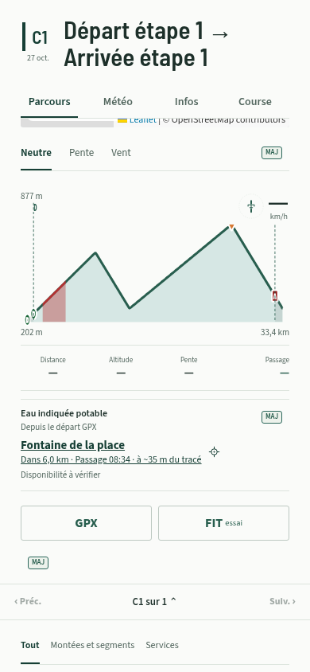
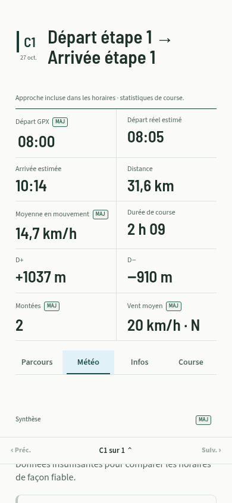
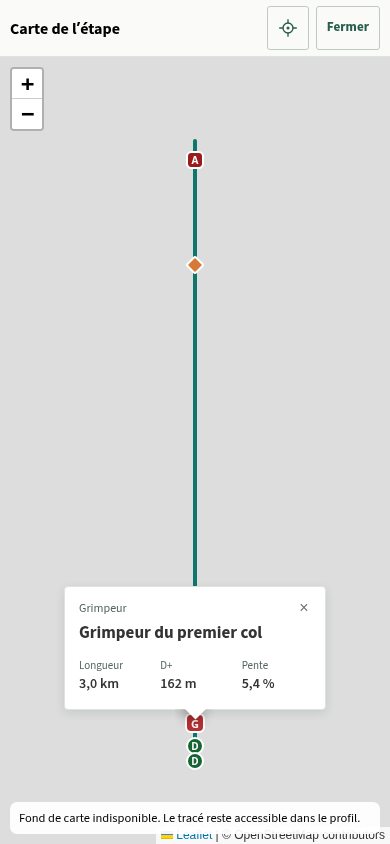

# Informations de parcours — 2026.10.26.3

Le [lot 2026.10.27.3](CLIMBS_COURSE_REPRESENTATION.md) remplace le raccourci Prochaine eau et fait évoluer les repères de carte/profil. Ce document conserve les règles historiques du lot du 26 octobre.

Ce lot finalise les quatre suggestions retenues après les retours iPhone et simplifie la carte de détail en League/Tour. L’origine du site, l’identité PWA, le stockage et les exports restent inchangés.

## Profils

Le grand profil et les mini-profils utilisent une seule palette, avec les classes de pente existantes : vert, jaune, orange, rouge et violet pour les montées, teintes froides pour les descentes. Les moyennes d’affichage restent adaptées à chaque largeur ; une couleur représente désormais la même classe sur les deux vues. Relief, dénivelés, catégories et horaires ne sont pas recalculés.

Le grisé des portions hors course est léger et limité à la silhouette du relief. Les repères du départ réel et de l’arrivée restent visibles ; le tracé GPX complet reste consultable.

## Prévisions anciennes

Le modèle de lecture calcule l’âge de réception à partir de son horloge et du `fetchedAt` existant. Au-delà du seuil de confiance déjà utilisé par les recommandations, **six heures**, une mention discrète indique « Prévision reçue il y a … ». Elle apparaît dans le détail, Météo et les aperçus. Absence de données, horodatage inconnu/invalide ou journée passée ne produisent pas de fausse ancienneté.

La mention ne masque pas les prévisions conservées et ne lance aucune requête. Au retour de l’application au premier plan, l’affichage est réévalué avec l’horloge courante. Les mécanismes de cache, de risque et de recommandation existants sont conservés.

## Prochaine eau

Le repère apparaît lorsqu’un point d’eau est déjà enregistré pour l’étape. Il prend comme origine le point exploré sur le profil, puis le **départ GPX** au repos. Il affiche le nom, la distance restante sur le tracé, l’heure estimée de passage et l’écart au tracé. L’itinéraire externe utilise le mode vélo ou marche.

Seuls les points explicitement cartographiés comme potables sont suggérés : `amenity=drinking_water` ou `drinking_water=yes`, sans indication contradictoire. Les points masqués, privés/réservés, sans chaînage exploitable ou connus fermés à l’heure de passage sont exclus de la suggestion. Les anciens lieux sans ces tags restent sauvegardés et consultables dans Services. Un point rattaché à une autre étape n’apporte pas son chaînage à celle-ci.

L’heure provient de la même courbe que le profil et les passages, avec leur modèle de terrain, pauses et approche. Elle reste « — » quand cette courbe ne peut pas fournir d’horaire. Il s’agit du passage **sur le tracé** : le temps d’accès au point et l’arrêt pour remplir ne sont pas ajoutés. L’écart indiqué est géométrique, sans trajet d’accès inventé. La disponibilité sur place reste à vérifier ; un tarif connu est signalé. Aucune position GPS réelle n’est supposée.

Le bloc garde sa hauteur pendant l’exploration. Le retrait du doigt restaure l’origine ; un blur répété ne recrée pas le lien au moment où l’on le touche. Les résultats sont préparés depuis les POI sauvegardés, recherchés par chaînage, sans appel météo ou POI supplémentaire. La longueur de la géométrie est réutilisée lors des mises à jour progressives.

## Carte du détail

En **League/Tour**, le bouton et le panneau Calques sont retirés. Toucher un marqueur de montée ou de segment ouvre une fiche : nom, longueur, D+ et pente moyenne. Le segment coloré ouvre également sa fiche. Les mêmes analyses que la liste alimentent ces valeurs ; une altitude incomplète reste explicite et les annotations périmées ne créent pas de faux repères. Les montées remplacées par un segment ne réapparaissent pas sur la carte.

La petite carte reste un accès au plein écran, y compris lorsqu’on touche un marqueur. Les fiches s’ouvrent uniquement en plein écran et restent contenues à 320/390/430 px. Leur fermeture est accessible au toucher et le retour système conserve son comportement de fermeture des superpositions. **Voyage conserve ses calques de services**, et Aperçu son bouton Détail.

Un défaut Leaflet a été reproduit en fermant la carte pendant un zoom : sa fin d’animation différée accédait à une carte déjà détruite. Le zoom des cartes partagées est désormais instantané ; zoom, déplacement et fermeture restent disponibles, sans dépendre des API privées de Leaflet.

## Vérification

- `npm run build` et `npm test` : **2 307 tests réussis**, aucun échec ni test ignoré. Les onze nouveaux scénarios couvrent palette commune, ancienneté, absence de Calques en compétition, fiches et données périmées, potabilité/accès/fermeture, chaînage, horaires après minuit, échappement des textes, stabilité du lien et arrivée progressive des points d’eau.
- `python scripts/check-tripplus-mobile.py` sur le build compilé : parcours de 150 km, GPX/FIT de 1 514 points, fiches de segment et accès plein écran depuis le marqueur compact, rechargement et randonnée hors connexion, champs et zone supérieure, navigation et repères Tour. Aucune erreur JavaScript dans ces scénarios.
- `python scripts/check-route-information.py` avec Vite sur le port 5173 : contrôle isolé des vrais modules, GPX synthétique, POI et météo déterministes. League et Tour : sélection du prochain point en écartant les points privés/fermés/inconnus, distance et passage partagés, prévision âgée de huit heures au retour au premier plan, hauteur stable et absence de nouvelle requête pendant l’exploration. Fiches de segment/montée, largeurs 320/390/430 px et fermeture pendant un zoom : aucune erreur JavaScript.

Les navigateurs de contrôle utilisent Chromium tactile. Le contrôle physique de cette version sur iPhone reste nécessaire après fusion/déploiement, sans réinstaller l’application. Les données cartographiques ne garantissent pas la disponibilité d’un point d’eau ; le FIT conserve son statut essai pour les alertes sur Garmin Edge Explore 2.

Captures du contrôle isolé, avec données synthétiques et fond réseau bloqué :

