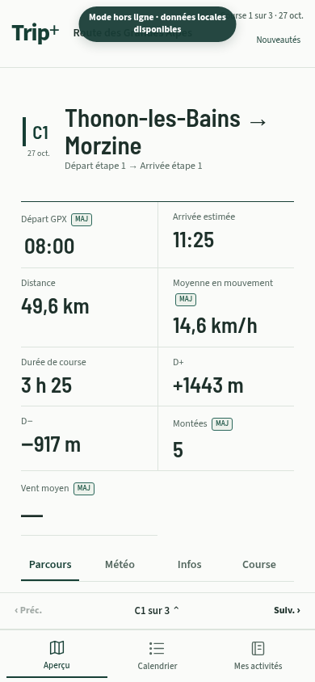
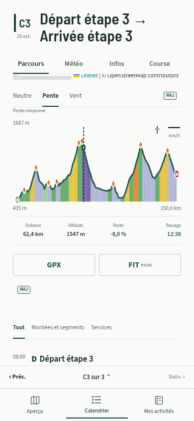
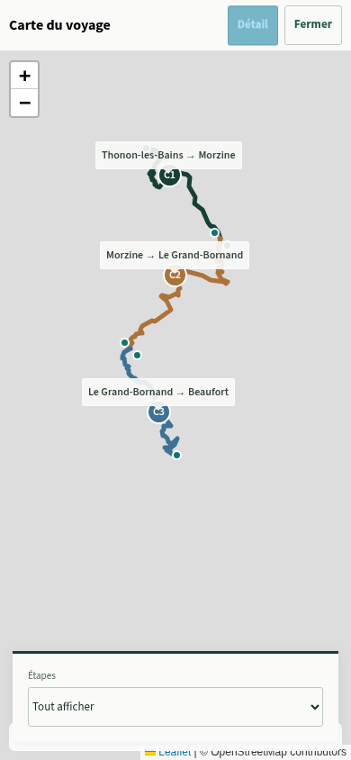

# Trip+ — interface mobile validée, 2026.10.26.1

> Le [lot iPhone 2026.10.26.2](IPHONE_POLISH.md) corrige les champs natifs, les marges d’encoche, l’effacement des lectures au relâchement et les repères des étapes d’un même jour en Tour.

Cette intégration reprend la direction visuelle approuvée le 26 octobre : vert profond, fond clair, Source Sans 3 pour la lecture et Barlow Semi Condensed pour les titres et chiffres. Les surfaces sont allégées, avec des séparations utiles plutôt qu’un empilement de cartes arrondies. Les polices sont livrées avec l’application, sous licence OFL, et mises en cache par son Service Worker.

Les règles ci-dessous remplacent les anciens choix d’interface lorsque les documents des lots précédents divergent. Les modèles de parcours, les réglages d’allure, les recherches POI et les formats d’export ne changent pas.

## Lire et préparer une étape

Toutes les statistiques restent directement visibles, avant la carte et le profil. La rangée unique propose **Parcours / Météo / Infos / Course**, ce dernier en League et Tour. Le profil neutre de lecture est déplacé dans Course pour préparer les limites et segments, puis remis à sa place ; les formulaires et les protections des modifications non enregistrées restent actifs.

Les commandes précédente/suivante et le choix de journée sont placés au-dessus de la navigation basse, à portée du pouce. Le sélecteur traverse les journées de repos et de transfert comme les étapes. L’espace de fin de page évite de masquer les derniers points ou les exports. Les onglets répondent aussi aux flèches du clavier, Début et Fin. Les cartes masquées par un onglet sont redimensionnées à leur réapparition.

Les filtres **Tout / Montées et segments / Pauses / Services** s’adaptent au mode. Ils changent uniquement l’affichage ; les horaires, pauses, montées retenues et traces ne sont pas recalculés. Services lit les POI déjà enregistrés, ordonnés par leur chaînage GPX, par groupes de 50 pour contenir la taille du DOM. Les pages suivantes restent accessibles. Une météo existante est reprise uniquement si le point de passage associé est à 1 km maximum, avec la mention « Météo à proximité » ; aucune prévision exacte n’est inventée et ce filtre ne lance pas de recherche réseau.

Les fiches POI existantes restent disponibles sur la carte. Une nouvelle fiche basse systématique et une frise météo supplémentaire ne sont pas ajoutées. La météo aux points de passage reste présente.

## Profils et vent

Le vent relatif et sa vitesse disposent d’un emplacement réservé dans l’angle supérieur droit du profil. La zone est présente avant toute sélection et reste de même hauteur, avec une valeur inconnue explicite lorsque les données manquent. Aucun texte « Vent vers le km… » n’est ajouté sous le profil. Les sommets gardent leur espace de lecture.

Chaque nouveau profil d’étape s’ouvre en **Neutre**, indépendamment de l’ancienne préférence globale. Le choix courant reste utilisable dans l’étape ; ouvrir Course impose temporairement Neutre, sans recréer le profil. Aucun zoom ni plein écran de profil n’est ajouté. Le vent demeure masqué en randonnée.

Les bandes de coloration sont regroupées selon la largeur disponible, autour de 9 pixels par bande, avec des bornes de 20 à 120. La pente est pondérée par les distances couvertes, et les zones insuffisamment couvertes restent inconnues. Le vent utilise une moyenne vectorielle sur la portion représentée. Le profil principal réagit à son redimensionnement ; les mini-profils réévaluent leur coloration à leur ouverture. La silhouette et les données d’interaction détaillées restent celles d’origine. Des triangles discrets signalent les rampes d’au moins 12 % du profil préparé, avec un espacement visuel et un plafond de huit repères.

Cette simplification concerne la représentation : elle ne modifie ni les points GPX, ni le calcul des dénivelés, ni les catégories, ni les ETA. Les observateurs de profil et les cartes compactes sont libérés lorsque leur écran est quitté.

## Carte d’Aperçu

Chaque tracé garde sa propre ligne, sans connecter artificiellement des étapes séparées. Sa couleur et son numéro suivent l’ordre d’étapes enregistré, commun aux listes et au calendrier. Les couleurs des segments de compétition restent indépendantes.

Le clic sur la petite carte ouvre toujours la carte plein écran. Les numéros y sont accessibles ; **Détail** ajoute les noms. Toucher une ligne ou un numéro met cette étape en évidence, atténue les autres et ouvre sa fiche : nom, distance, D+ et accès au détail. Le sélecteur bas permet aussi de choisir une étape lorsque des tracés se superposent. **Tout afficher** rétablit l’ensemble. Le placement des numéros utilise la moitié de la distance de chaque trace, plutôt que la moitié du nombre de points.

Les transitions de zoom de la carte d’Aperçu sont désactivées pour éviter un rappel Leaflet après une fermeture rapide. Panoramique, zoom et retour système restent disponibles. Le fond demeure celui d’OpenStreetMap ; le fond schématique de la maquette n’est pas utilisé dans l’application.

Une fin de recherche en arrière-plan ne reconstruit pas la carte pendant sa consultation. La vue est actualisée après fermeture si ses données ont changé ; des données d’Aperçu identiques ne provoquent aucun remontage, même si Leaflet a enrichi le DOM.

## Données et mises à jour

Le nom visible devient **Trip+**. L’origine, les chemins, l’identifiant `id`, `start_url`, le périmètre du manifeste, les icônes et le schéma IndexedDB restent inchangés. Aucune réinstallation ou suppression de stockage n’est demandée. Les GPX enregistrés et les sauvegardes restent compatibles. Les polices sont consultables hors connexion après la préparation normale du cache.

Version chargée : **2026.10.26.1**. L’historique Nouveautés et les balises MAJ locales décrivent les changements de présentation, de profil et de carte. Le FIT garde son indication **essai** tant que la validation physique des alertes sur Garmin Edge Explore 2 n’a pas été communiquée.

## Vérifications et captures

`npm run build` puis `npm test` : **2 285 tests réussis**, aucun échec ni test ignoré. Les huit nouveaux scénarios couvrent la pondération par distance, les densités d’échantillonnage différentes, les trous de couverture, le budget de bandes sur 150 km, les statistiques complètes et onglets, l’identité des étapes dans le modèle de carte, l’échappement des services, leur pagination et le report des mises à jour pendant la consultation de la carte.

Chromium tactile à **320, 390 et 430 × 844** sur l’application compilée : import GPX de 50, 78 et 150 km, profil partagé avec Course, ajout d’un Grimpeur, onglets et filtres, choix de journée au pouce, retour en Neutre, trois lignes/étiquettes d’étape, mise en évidence et navigation depuis la carte. Rechargement et modifications hors connexion, polices en cache, exports GPX/FIT et passage à pied avec segment conservé. Aucun débordement horizontal ni erreur JavaScript dans ces scénarios.

Un fournisseur météo déterministe vérifie séparément la moyenne cardinale, le vent sur les quatre passages, les montées et le segment, le repère au point exploré et la coloration du profil. Une lecture FIT indépendante par fitdecode valide le CRC et la correspondance des **1 514 points** de la trace testée. Les copies d’export et le GPX source sont comparés sommet par sommet. Les tuiles réseau sont bloquées pendant les contrôles pour vérifier le repli ; l’essai physique sur iPhone et les alertes Garmin restent à réaliser après fusion et déploiement.

Le contrôle tactile est reproductible avec Python, Playwright et Chromium : servir le build avec `npm run preview -- --host 127.0.0.1 --port 4173`, puis lancer `python scripts/check-tripplus-mobile.py`. Son contexte navigateur est isolé et son dossier de sortie contient les captures et exports de contrôle.

Captures de l’application, avec données de contrôle et fond réseau indisponible :

